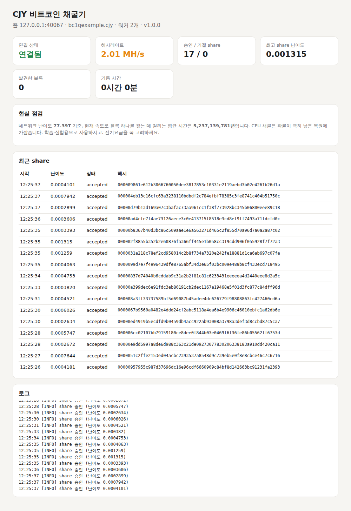

# CJY 비트코인 채굴기

내 컴퓨터의 CPU로 비트코인을 채굴하는 프로그램입니다. Python 표준 라이브러리만으로 만들었기 때문에 따로 설치할 패키지가 없고, 실행하면 브라우저에 채굴 현황 대시보드가 열립니다.



## 먼저 알아두실 점

CPU 채굴로 돈을 벌 가능성은 사실상 없다고 보시는 편이 정확합니다. 이 프로그램은 코어당 약 1 MH/s(초당 100만 번) 정도로 해시를 계산하는데, 현재 비트코인 네트워크 전체는 일반 PC 한 대보다 수백조 배 이상 빠른 전용 장비(ASIC)들로 경쟁하고 있습니다. 대시보드의 "현실 점검" 칸에 지금 속도로 블록 하나를 찾는 데 걸리는 평균 시간이 표시되는데, 보통 수십억 년 단위로 나옵니다.

따라서 이 프로그램은 다음과 같은 용도로 쓰시는 것이 맞습니다.

- 비트코인 채굴이 실제로 어떻게 돌아가는지(블록 헤더, 머클 루트, nonce, 난이도, Stratum 프로토콜) 직접 보고 배우는 교육·실험용
- 아주 희박한 확률에 거는 "솔로 채굴 복권" (블록을 찾으면 보상 전액이 내 주소로 들어갑니다)

컴퓨터를 계속 최대 부하로 돌리면 전기요금이 들고 발열이 생기므로, 노트북에서는 `--threads`로 코어 수를 줄여 쓰시기를 권합니다.

## 준비물

1. **Python 3.8 이상** — https://www.python.org/downloads/ (Windows 설치 시 "Add Python to PATH"를 체크하세요)
2. **본인의 비트코인 주소** — 지갑 앱(예: Sparrow, BlueWallet, 거래소 입금 주소는 비권장)에서 받은 `bc1...` 형태의 주소. 개인 키나 시드 문구는 절대 입력하지 않습니다. 채굴기는 주소만 필요합니다.

## 실행 방법

### Windows
`run_windows.bat`을 더블클릭하고 비트코인 주소를 입력하면 됩니다.

### macOS / Linux
```sh
./run.sh
```

### 직접 실행
```sh
python -m btcminer --address bc1q여기에본인주소
```

실행하면 브라우저에 `http://127.0.0.1:8080` 대시보드가 열립니다. 종료는 터미널에서 `Ctrl + C`.

## 주요 옵션

| 옵션 | 설명 | 기본값 |
|---|---|---|
| `-a, --address` | 보상을 받을 비트코인 주소 | (필수) |
| `-o, --pool` | 풀 주소 `host:port` | `solo.ckpool.org:3333` |
| `-t, --threads` | 사용할 CPU 코어 수 | 전체 코어 − 1 |
| `-w, --worker` | 워커 이름 (여러 PC 구분용) | `cjy` |
| `-u, --user` / `-p, --password` | 일반 풀용 사용자 이름/비밀번호 직접 지정 | 주소.워커 / `x` |
| `--port` | 대시보드 포트 | `8080` |
| `--no-dashboard`, `--no-browser` | 대시보드 끄기 / 브라우저 자동 열기 끄기 | |
| `--benchmark 초` | 풀 접속 없이 내 PC의 해시 속도만 측정 | |

예시:
```sh
python -m btcminer --benchmark 10                      # 속도 측정
python -m btcminer -a bc1q... -t 2                     # 코어 2개만 사용
python -m btcminer -a bc1q... -o public-pool.io:21496  # 다른 솔로 풀 사용
```

## 풀에 대하여

기본값인 `solo.ckpool.org`는 수수료 2%의 **솔로 풀**입니다. 일반 풀처럼 작은 보상을 나눠 받는 방식이 아니라, 내가 블록을 찾았을 때만 블록 보상 전체(수수료 제외)를 받습니다. 사용자 이름이 곧 지급 주소이므로 회원가입이 필요 없습니다. `public-pool.io:21496` 같은 다른 솔로 풀도 같은 방식으로 쓸 수 있습니다.

대시보드에 보이는 "share"는 풀이 정한 낮은 난이도를 만족한 결과로, 내 채굴기가 제대로 일하고 있다는 증거일 뿐 보상은 아닙니다. "최고 share 난이도"가 네트워크 난이도에 도달하면 그것이 곧 블록 발견입니다.

## 구조

```
btcminer/
  core.py       SHA-256d, 블록 헤더·머클 루트 조립, 난이도↔타깃 변환
  worker.py     코어마다 실행되는 채굴 프로세스 (midstate 재사용으로 최적화)
  stratum.py    Stratum v1 풀 통신 (subscribe/authorize/notify/submit, 재접속)
  app.py        워커·풀 연결·통계를 묶는 본체
  dashboard.py  로컬 웹 대시보드 (127.0.0.1에서만 열림)
  __main__.py   명령줄 실행 진입점
tests/
  test_core.py  실제 제네시스 블록과 1번 블록으로 해시 계산 검증
  test_pool.py  가짜 풀 서버를 띄워 접속→작업 수신→share 제출 전 과정 검증
```

시험 실행: `python -m unittest discover -s tests -v`
